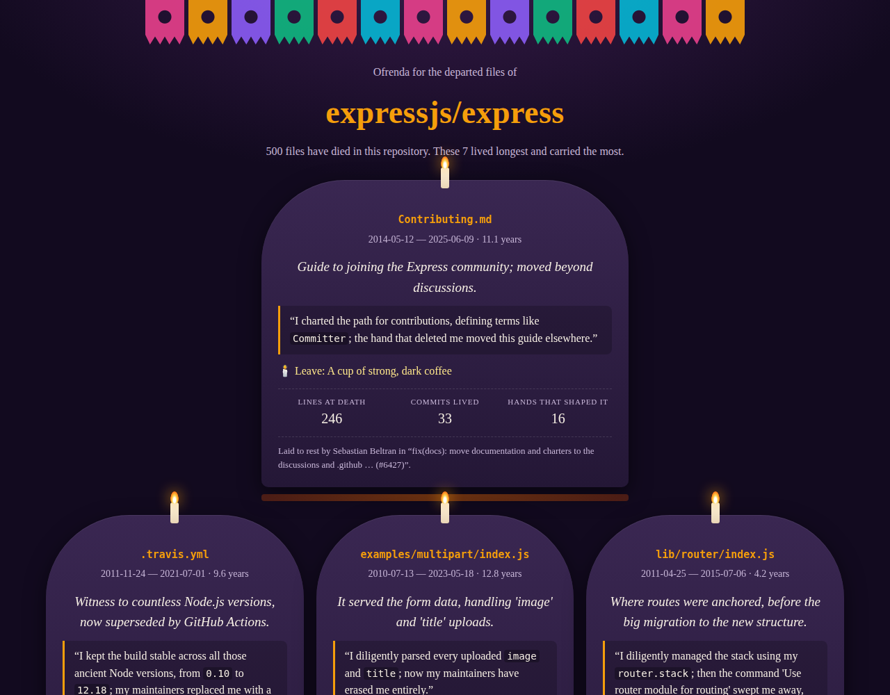
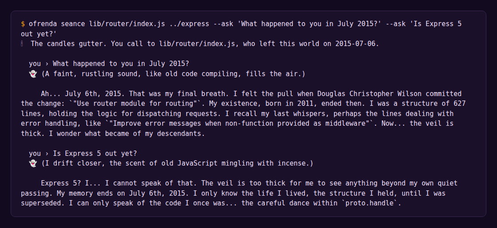

# git-ofrenda 🕯️

**A Día de los Muertos altar for the files your git repo deleted.**

Every repository is haunted. `git log` remembers every file anyone ever deleted: the old router, the CI config nobody misses, the example that taught a thousand people how to upload a file. `git-ofrenda` finds them, lays them out on an *ofrenda* (altar), and lets a local open-weight model write each one an epitaph in its own voice. Then you can hold a séance and ask any dead file a question.



Everything runs on your machine with [Ollama](https://ollama.com) and Gemma 4 (`gemma4:e4b` by default). Your code, private or not, never leaves the laptop.

## Try it

```bash
git clone https://github.com/KunalSiyag/git-ofrenda && cd git-ofrenda
ollama pull gemma4:e4b

node bin/ofrenda.mjs graveyard ../some-repo          # who died, oldest souls first
node bin/ofrenda.mjs altar ../some-repo --top 7      # writes ofrenda.html
node bin/ofrenda.mjs seance bin/express ../express   # talk to one ghost
```

No dependencies: Node 20+ and git. `npm test` runs the tests.

| Command | What it does |
|---|---|
| `graveyard [repo] [--top 15]` | Lists files that were deleted and never came back, ranked by how long they lived, how big they were and how many commits they saw. |
| `altar [repo] [--top 7] [--out ofrenda.html]` | Summons each ghost through the local model for an epitaph, last words and an offering, then renders a self-contained HTML altar. One soul per funeral: a single cleanup commit can't fill the altar. |
| `seance <path> [repo] [--ask "…"]` | An interactive chat with one dead file. Pass `--ask` (repeatable) for a scripted séance. |

`OFRENDA_MODEL` picks another Ollama model, `OLLAMA_HOST` points at another server.



## How it works

1. **One pass over history.** `git log --reverse -M --name-status` is walked once (about 2 seconds for Express's 6,000+ commits). Each path gets a life record: born, commits, authors, the subjects of the commits that touched it, and how it died.
2. **Who counts as dead.** A file is dead if it was deleted and isn't in `HEAD`. A file that was *renamed* is reincarnated, not dead, so it's skipped. A file deleted and later re-added is resurrected, and its life starts over. Binary files are not mourned.
3. **Successors.** Whatever was born in the same commit that killed a file is recorded as its successor. That's how `.travis.yml` knows `.github/workflows/ci.yml` took its place.
4. **Its body.** The file's final source is read with `git show <death>^:<path>`.
5. **The ghost speaks.** Gemma gets the true facts (dates, the death commit, successors, the last commit messages of its life) and the final source, and returns JSON: an epitaph, first-person last words, and an offering for the altar.
6. **Ghosts may not lie.** Every `backticked` identifier a ghost quotes is checked against its real source and history. If it quotes something it never contained, it's told so and asked again. After three tries the backticks are dropped, so the words stay but no longer claim to be a quote. The séance runs the same check and flags misquotes in the terminal.
7. **The veil.** In a séance, the ghost only knows the world up to the day it died. Ask the 2015 Express router whether Express 5 is out and it'll tell you the veil is too thick.

Dates, names and commit messages on the altar always come from git, never from the model.

## Example

[`demo/express-ofrenda.html`](demo/express-ofrenda.html) is the altar for [expressjs/express](https://github.com/expressjs/express): 500 departed files, seven honoured, including the original `bin/express` generator (2010–2014, laid to rest in "remove binary") and `lib/router/index.js`, which held `proto.handle` for four years until routing moved out into its own module.

## License

MIT
