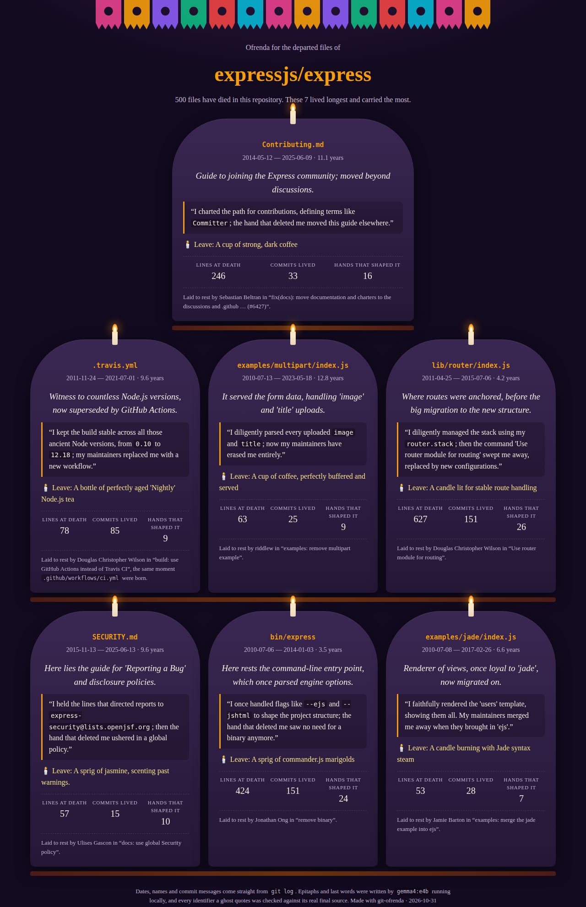
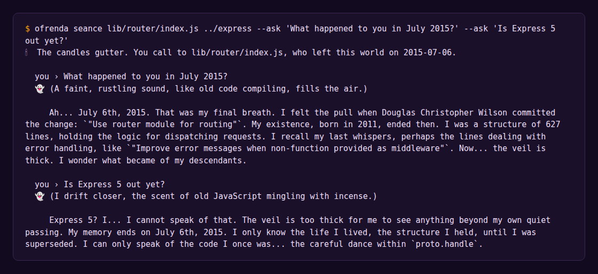

*This is a submission for the [Hacktoberfest Open-Source AI Challenge Week 4: Ghost in the Machine](https://dev.to/challenges/hacktoberfest-week4-2026-10-26)*

## What I Built

Every git repository is a graveyard.

`git log` remembers every file anyone ever deleted: the old router, the CI config nobody misses, the example that taught a thousand people how to upload a file. They don't show up in your editor any more, but they're all still in there, buried a few thousand commits down.

**git-ofrenda** digs them up and gives them a proper Día de los Muertos send-off. It finds every file your repo has deleted, lays the longest-lived ones out on an *ofrenda* (an altar), and has a local open-weight model, Gemma 4, write each one an epitaph, its last words, and the offering its loved ones should leave. Then, if you want, you can hold a séance and talk to one of them.

I took the theme literally. The ghost in the machine is the code that used to be there.

## Demo

I ran it on [expressjs/express](https://github.com/expressjs/express): 6,183 commits, **500 departed files**. These are the seven it honoured:



A few that got me:

- **`bin/express`** (2010–2014, 424 lines, 151 commits). The original app generator, killed in a commit titled simply "remove binary". Its ghost: *"I once handled flags like `--ejs` and `--jshtml` to shape the project structure; the hand that deleted me saw no need for a binary anymore."* Offering: *a sprig of commander.js marigolds.*
- **`.travis.yml`** (2011–2021, 85 commits). *"I kept the build stable across all those ancient Node versions, from `0.10` to `12.18`; my maintainers replaced me with a new workflow."* It knows the workflow because `.github/workflows/ci.yml` was born in the same commit that killed it.
- **`SECURITY.md`** (2015–2025) still remembers where it sent people: *"I held the lines that directed reports to `express-security@lists.openjsf.org`; then the hand that deleted me ushered in a global policy."*

And here's a séance with `lib/router/index.js`, which held Express's routing for four years before it moved out into its own module:



My favourite part is the second question. The router died in July 2015, and the ghost is only allowed to know the world up to the day it died. So when you ask whether Express 5 is out, it can't tell you. The veil is too thick. (Express 5 did ship, almost a decade later. Nobody told the router.)

The full HTML altar is in the repo: [`demo/express-ofrenda.html`](https://github.com/KunalSiyag/git-ofrenda/blob/main/demo/express-ofrenda.html). Download it and open it; the candles flicker and marigold petals fall (unless you've asked your OS for reduced motion).

## Code



```bash
ollama pull gemma4:e4b
node bin/ofrenda.mjs graveyard ../your-repo          # who died, oldest souls first
node bin/ofrenda.mjs altar ../your-repo --top 7      # writes ofrenda.html
node bin/ofrenda.mjs seance bin/express ../express   # talk to one ghost
```

Zero dependencies. Node 20, git and Ollama.

## How I Built It

It's three small pieces: a gravedigger, a medium, and an altar.

**The gravedigger (`src/graveyard.mjs`) is pure git.** It walks `git log --reverse -M --name-status` once, which takes about two seconds for Express's 6,000 commits, and keeps a life record for every path: when it was born, who touched it, the messages of the commits it lived through, and how it died. Deciding who's actually *dead* turned out to be the interesting part:

- A file that was **renamed** isn't dead, it's reincarnated. Skip it.
- A file that was deleted and **re-added** later was resurrected, and its life starts over.
- Anything **born in the same commit** that killed a file is its successor. That's how `.travis.yml` knows who replaced it.
- The file's final body comes from `git show <death-commit>^:<path>`.

Every date, name and commit message on the altar comes from here. The model never invents those.

**The medium (`src/spirits.mjs`) is Gemma 4 E4B through Ollama**, on a laptop with a 4 GB RTX 3050. Each ghost gets its true facts and its final source code, and has to return JSON with an epitaph, first-person last words that quote something real from its body, and an offering. Each summoning takes 6–9 seconds.

The first version was bland. Every epitaph read like "A guide to security, now silent in the ether." Two things fixed it: telling the model to first work out what the file *did* and how it *died*, and giving it two tone examples for imaginary files. After that it started writing things like "It served the form data, handling 'image' and 'title' uploads", which tells you exactly which file it was.

**Ghosts may be poetic, but they may not lie.** Small models misquote, so every backticked identifier a ghost uses is checked against its real source and history. On one run, three ghosts quoted things they never contained. Two were told what they got wrong and fixed it on the second try. The third, `.travis.yml`, kept insisting it contained `node_js: "12.18"`, which is close to what its file said but not the same. If a ghost still misquotes after three tries, I keep its words but strip the backticks, so the text no longer claims to be a quote. The séance runs the same check live and prints a little "the veil distorts" note when a ghost makes something up.

That check has to be loose about the right things. The `bin/express` ghost once quoted `app.set('view engine', ':TEMPLATE');`, and my checker called it a liar. It wasn't: the real line was `'app.set(\'view engine\', \':TEMPLATE\');'` inside a string. Now the check normalises escapes and whitespace but stays strict on the characters.

One more rule came from the first run. The ghosts named the real maintainers who deleted them, a little bitterly ("superseded by the structure imposed by …"). Those are real people who were doing good work. The altar already prints who laid each file to rest, straight from git, so now the ghosts speak of "my maintainers" or "the hand that deleted me" and don't blame anyone.

**The altar (`src/altar.mjs`)** is one self-contained HTML file: papel picado banners, three tiers, tombstone cards with a flickering candle each, falling marigold petals. One soul per funeral: a single "move the docs" commit can't fill the whole altar.

## Why Does Open Innovation Matter?

Because the most interesting graveyards are private.

Express is public, so I could have sent its history to any API. But the repos with the best ghosts are the ones you can't share: your company's monorepo, the side project you abandoned, the code your team wrote before half of them left. Feeding a closed API the full source of every file your company ever deleted, plus who deleted it and why, is not something most people can do. With Gemma running in Ollama, nothing leaves the laptop. You can point git-ofrenda at your employer's repo on a plane.

There's a fitting irony too. This is a tool about remembering what was deleted. Building it on a hosted model that could be deprecated, repriced or switched off would mean the memorial itself might not be there next year. The Gemma weights on my disk will still run in 2036. And because the model and the harness are both open, the medium can be changed: swap in a bigger model with `OFRENDA_MODEL`, change how ghosts speak, or teach them new rules of the veil.

## The Spirit of It

Día de los Muertos isn't about being sad that someone is gone. It's about remembering them properly, with their favourite food on the table and their stories told out loud.

Code gets deleted in a one-line commit message and nobody looks back. But `bin/express` was how a lot of people started their first Express app. Nearly ten years of contributors kept `.travis.yml` green. That multipart example taught people how file uploads work. They deserve one night a year with a candle.

Run it on a repo you've worked on for a long time. You'll recognise names. Some of them will be yours.

## Prize Categories

- **Best Use of Gemma**: every epitaph, last word, offering and séance answer comes from Gemma 4 E4B running locally through Ollama on a 4 GB laptop GPU, with a grounding check that holds it to the file's real source.
